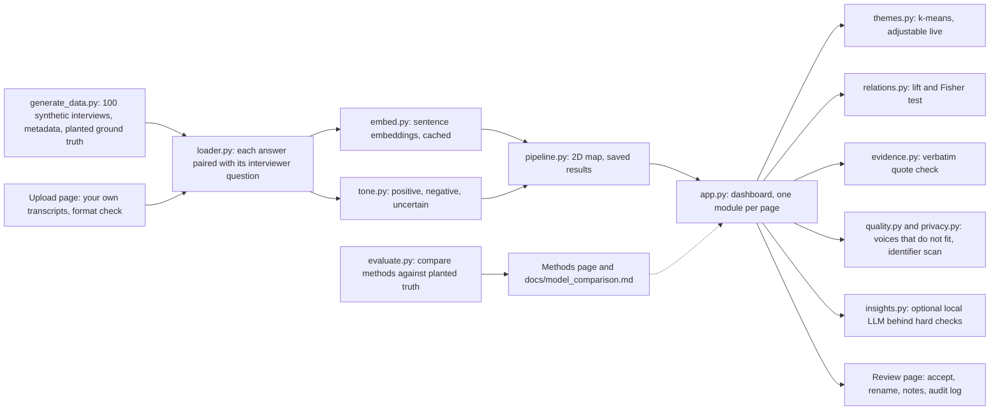
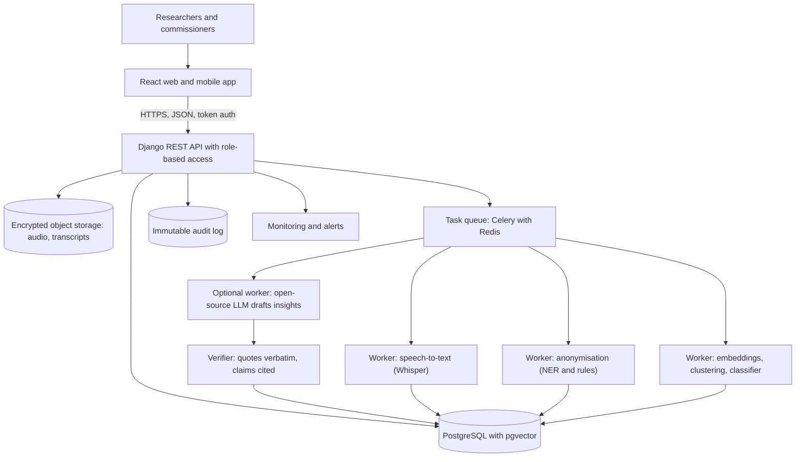

# NarrativeVoice prototype: technical documentation

## 1. Purpose and scope
The prototype shows how AI and NLP can turn interview transcripts from care-experienced young adults into
structured findings where **every finding links back to a participant and a line in the original transcript**.
A researcher then reviews, edits and approves the results. It uses **100 synthetic interviews**
(992 participant answers, no real data), and can also analyse non-sensitive transcripts uploaded by the user.

The prototype is deliberately small. It is a proof of concept, not a production system. Section 8 describes how I
would extend it.

## 2. How it meets the six requirements

| Requirement | What I built | Module |
|---|---|---|
| 1. Text processing | Reads `INTERVIEWER:` / `PARTICIPANT:` transcripts, checks the format, pairs each answer with its question | `loader.py`, Upload transcript (Streamlit app) |
| 2. Theme identification | Sentence embeddings, then k-means (k chosen by silhouette score, adjustable), stability check, keyword labels | `embed.py`, `themes.py` |
| 3. Semantic analysis | Which themes appear in the same people (lift and Fisher's exact test), a 2D map, semantic search | `relations.py`, Map and search page (Streamlit app) |
| 4. Evidence extraction | Representative quotes for each theme, one per participant, each checked verbatim against the source line | `evidence.py` |
| 5. AI-generated insights | A local LLM drafts short insights from verified quotes only; every claim must cite evidence and pass hard checks | `insights.py` |
| 6. Human validation | Researcher accepts, renames, edits or rejects each theme; notes, audit log, report export | Review page (Streamlit app) |

## 3. Architecture

Data flows in five stages: **input**, **processing** (run once, results saved to `results/`), **analysis** (live in
the dashboard), **safeguards**, and **human validation**. The dashboard is a Streamlit app (`app.py`) with one module
per page in `ui/`. The same diagram is given below as editable Mermaid source, showing which module does each job.



## 4. Pipeline, step by step
1. **Load.** Each participant answer becomes one row with its participant ID, line number, interviewer question and
   metadata (region, age band, time in care, ethnic group). Generic follow-up probes ("Can you say more?") keep the
   previous main question as context. Answers under 5 words are kept but not themed.
2. **Embed.** `all-MiniLM-L6-v2` (384 dimensions) turns each answer into a vector so that similar meanings sit close
   together. Vectors are cached on disk. A TF-IDF option works offline.
3. **Tone.** A small DistilBERT sentiment model labels each answer positive, negative or uncertain (confidence below
   0.8). A word-list fallback is used if the model is unavailable, and the dashboard says which one ran.
4. **Map.** t-SNE reduces the vectors to two dimensions for the map. Results are saved as `answers.csv` and
   `embeddings.npy`.
5. **Themes.** k-means groups the vectors. k is chosen between 6 and 16 by silhouette score, and the researcher can
   change it live. Each theme is labelled with its most distinctive words, and its stability across five random
   starts is reported.
6. **Relationships.** For every pair of themes, lift shows whether they appear in the same participants more than
   chance, and Fisher's exact test shows whether the pattern is likely to be noise.
7. **Evidence.** For each theme, the answers closest to its centre are selected, at most one per participant, and
   each quote is checked against the original file at the stated participant and line.
8. **Insight drafting (optional).** A local LLM (Ollama, `llama3.2:3b`, temperature 0) receives only the verified
   quotes. See section 5.
9. **Review and export.** The researcher decides the status of each theme. The report includes accepted themes only.

## 5. How unsupported content is kept out
- **Verbatim check.** A quote is accepted only if it appears word for word on that participant's line in the original
  transcript. On the demo data, 992 of 992 answers pass.
- **Restricted LLM input.** The model sees only verified quotes for one theme, never the whole corpus, and has to cite
  evidence numbers for every claim.
- **Validator.** A draft is rejected if a claim cites evidence that does not exist, mentions a participant ID, is
  missing or too long, or contains a number or number word that is not in its cited quotes. One broken rule rejects
  the whole answer.
- **Questioning the AI.** The Quality checks page lists voices that do not fit their theme and contrast cases (for
  example a positive placement story inside a mostly negative theme), so untidy voices are not smoothed over.
- **Privacy scan.** A pattern check flags emails, phone numbers, postcodes, names and addresses for a human to check.
  It is not anonymisation and misses many things.
- **Local only.** No participant text is sent to an outside service. Embeddings, sentiment and the LLM all run on the
  machine.

The validator cannot catch a claim that overreaches while citing real quotes. That is why a researcher reviews every
draft.

## 6. Human validation workflow
On the Review page the researcher sees each theme with its supporting quotes and their source participant and line.
They set the status (pending review, accepted, needs edit, rejected), rename the theme, and add
notes. Every action is written to `audit_log.jsonl` and decisions to `reviews.json`. The downloadable
`reviewed_findings.md` contains only accepted themes, with the share of participants who raised each one, the
tone of the answers and the researcher's notes. Quotes are re-checked against the transcripts when the report is
built, and any that fail are marked NOT VERIFIED. In a real study I would add a second
coder, an agreement score between researchers, and sign-off by the co-production group.

## 7. Technologies and why
| Choice | Why |
|---|---|
| Python, pandas, scikit-learn | Standard, readable, quick to build |
| Sentence-transformers (MiniLM) | Matches meaning rather than keywords, small, runs locally |
| k-means with silhouette | Simple, every answer gets a theme, easy to explain and to adjust live |
| DistilBERT sentiment | Small and local; tone is separate from topic, so one theme can hold good and bad experiences |
| Ollama with a 3B model | Keeps text on the machine; the same approach scales to Llama 3 or Mistral 7B |
| Streamlit | Fastest way to show the analysis and the review step in a demo |
| Synthetic data with planted patterns | Safe, and lets me test whether the pipeline recovers known truth |

The full reasoning, with alternatives and costs, is in `decisions.md` (18 records). Measured comparisons are in
`model_comparison.md`.

## 8. Extending it to a secure, scalable application

The same design as editable Mermaid source:



- **Application:** React web and mobile front end, Django REST API with role-based access and token authentication,
  talking over HTTPS with JSON.
- **Data:** PostgreSQL with pgvector for themes, quotes, embeddings and reviews; encrypted object storage for audio,
  video and transcripts; an append-only audit log; UK-region hosting.
- **Processing:** Celery and Redis queue the slow jobs so users never wait on an upload. Separate Docker workers run
  speech-to-text (Whisper), anonymisation (NER plus rules, then a human spot check), embeddings and clustering, and an
  open-source LLM. A verifier sits between the LLM and the database.
- **Better themes:** researchers hand-code a gold-standard set against the co-produced taxonomy, a classifier is fine-tuned on
  it, and clustering is kept to find themes the taxonomy missed.
- **Governance:** ethics approval and a data protection impact assessment, retention rules, monitoring, and a log of
  model and prompt versions for every output.
- **Fairness:** accuracy and agreement tested across ethnicity, disability and region before any output is trusted.

## 9. Evaluation (on synthetic data)
Because the demo data has planted topics, I can score methods against the truth (`python src/evaluate.py`).

| Measure | Result |
|---|---|
| Quote verification | 992 of 992 found verbatim |
| Tone vs planted stance | 79.9% agreement (DistilBERT) vs 64.0% (word list) |
| k-means on MiniLM, auto k | adjusted Rand index 0.37, 15 themes found for 8 planted, stability 0.42 |
| HDBSCAN on MiniLM | adjusted Rand index 0.65, but only 44.8% of answers assigned |
| Automated tests | 7 passing (`pytest`) |

The data is template-built and easier than real interviews, so these numbers rank methods and do not estimate real
accuracy.

## 10. Limitations
- Synthetic, template-based data: results are cleaner than real interviews.
- Automatic k finds more themes than were planted, and theme stability is moderate. The researcher can override k,
  and the review step exists for this reason.
- Each answer gets one theme, so long answers covering two topics are simplified.
- Tone is approximate.
- Subgroup comparisons are exploratory and noisy for small groups; they are not a fairness audit.
- The privacy scan is not anonymisation.
- Audio and video transcription is not implemented in the prototype (Whisper is proposed in section 8).
- The LLM insight needs Ollama running, and its validator cannot detect claims that overreach while citing real quotes.

## 11. Run it
See the Quick start in the main `README.md` (environment, install, `streamlit run app.py`, optional Ollama setup).

## 12. Repository layout
```
app.py            dashboard entry point
src/              pipeline and analysis modules
ui/               one module per dashboard page
data/             synthetic transcripts, metadata, planted ground truth
results/          saved outputs read by the dashboard
docs/             this document (including the architecture diagrams), decisions, model comparison, diagram images
tests/            automated tests
```
